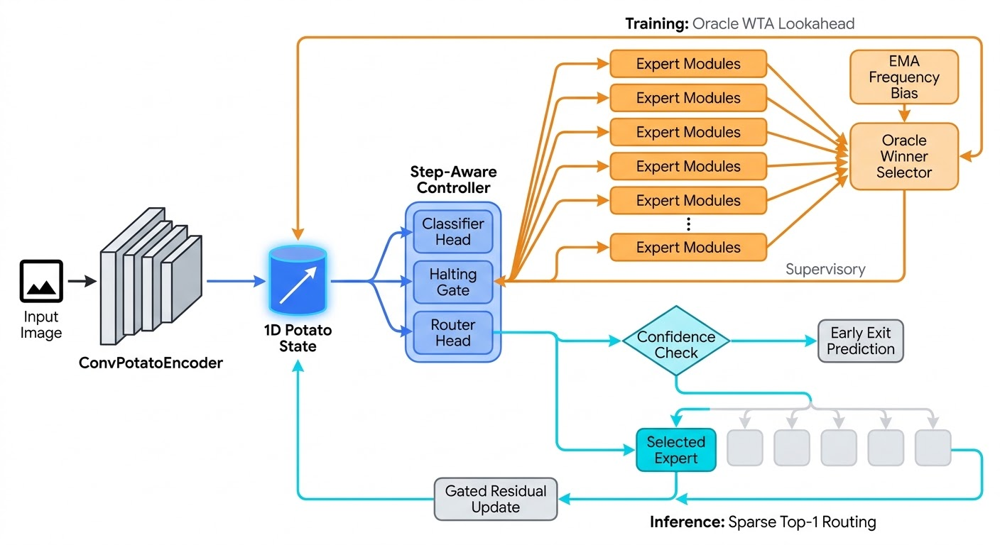

Ross Berger  
ECE-110  
UCSC Fall Quarter 2026

# Parade of Experts Project Proposal

## Outline

My intention is to develop an experimental technique for deep learning that combines concepts from RNN's 
and "Mixture of Experts" models. Basically, the idea is to pass the hidden state to a sequence of specialized experts during inference. 

1. **The "Potato" ($z_t \in \mathbb{R}^{d}$):** Instead of passing activations through a fixed stack of layers, an input image is encoded into a 1D latent vector $z_0$ called the *potato* ($d = 128$). This vector serves as a recurrent working-memory state that gets passed from expert to expert and iteratively refined.
2. **The Central Controller:** At each pass $t \in \{0, 1, \dots, T_{\max}\}$, the controller inspects the current potato $z_t$ (injected with a step embedding $e_t$) and makes three predictions:
   - **Class Logits ($\hat{y}_t$):** What class does the potato currently look like?
   - **Halting Logit ($h_t$):** Is the representation already confident and refined enough to stop, or does it need another expert pass?
   - **Routing Logits ($r_t$):** If we don't stop, which of the 8 specialized experts should refine the potato next?
3. **The Expert Pool ($E_1, \dots, E_N$):** A set of 8 independent neural modules. When an expert receives $z_t$, it computes a proposed modification $\tilde{z}_t$ and applies a **GRU-style gated residual update** so it refines the potato without erasing prior context.

## Motivation

The goal is to create a model that leverages the advantages of recursive "thinking," and can perform inference using less compute than a model that uses a fixed architecture of layers.

* Reduce the load on computation and memory, improving efficency
* Develop an architecture that will help mitigate temporal and spatial credit assignment problems when used in conjunction with non-back-propagation forms of deep learning.
* Build a comptational model that simulates the Global Workplace Theory of human cognition

## Background

**Universal Transformers** loop a forward pass iteratively through one block of layers (_Dehghani et al._ ICLR 2019). Saunshi et al. (2025) showed how a model that loops through *L* layers *k* times can achieved the same expressivity as a deeper block that contains *L* * *k* layers, allowing a model to achieve equivalent performance with only a fraction of the parameters of the larger model.

**Deep Recurrent Mixture of Experts** by Chazan et al. (2017) combines RNN's with MoE to handle time-series data like speech signal processing. In that architecture, each expert is an RNN, with its own hidden state that "remembers" data from the past. Experts are consulted by the router and do not share information with one another

## Implementation plan

## Evaluation plan

## Deliverable

## Referrences

The Consciousness Prior (Bengio, 2017/2019)

