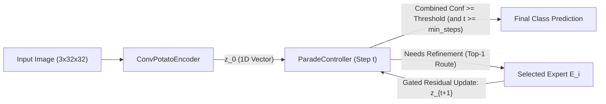

# How the Current Parade of Experts (CIFAR-10) Works

This document explains the architecture, Oracle-Guided Winner-Take-All (WTA) training procedure, and adaptive test-time inference mechanism implemented in [`cifar_10_parade_of_experts_training_script.py`](file:///home/user/vscodeprojects/parade_of_experts/cifar_10_parade_of_experts_training_script.py).

---

## 1. High-Level Concept

The **Parade of Experts (PoE)** combines ideas from **Recurrent Neural Networks (RNNs)** and **Mixture-of-Experts (MoE)** models to achieve adaptive, multi-pass computation:

1. **The "Potato" ($z_t \in \mathbb{R}^{d}$):** Instead of passing activations through a fixed stack of layers, an input image is encoded into a 1D latent vector $z_0$ called the *potato* ($d = 256$). This vector serves as a recurrent working-memory state that gets passed from expert to expert and iteratively refined.
2. **The Central Controller:** At each pass $t \in \{0, 1, \dots, T_{\max}\}$, the controller inspects the current potato $z_t$ (injected with a step embedding $e_t$) and makes three predictions:
   - **Class Logits ($\hat{y}_t$):** What class does the potato currently look like?
   - **Halting Logit ($h_t$):** Is the representation already confident and refined enough to stop, or does it need another expert pass?
   - **Routing Logits ($r_t$):** If we don't stop, which of the $N$ specialized experts should refine the potato next?
3. **The Expert Pool ($E_1, \dots, E_N$):** A set of $N = 8$ independent neural modules. When an expert receives $z_t$, it computes a proposed modification $\tilde{z}_t$ and applies a **GRU-style gated residual update** so it refines the potato without erasing prior context.

---

## 2. Architectural Components

### 2.1 `ConvPotatoEncoder` (Initial Encoding)
Raw $3 \times 32 \times 32$ CIFAR-10 images first pass through [`ConvPotatoEncoder`](file:///home/user/vscodeprojects/parade_of_experts/cifar_10_parade_of_experts_training_script.py#L79-L102), which uses a 4-stage residual convolutional backbone ([`ResidualConvBlock`](file:///home/user/vscodeprojects/parade_of_experts/cifar_10_parade_of_experts_training_script.py#L55-L76)):
- **Stage 1 ($32 \times 32$):** `Conv2d(3 -> 64)` followed by `ResidualConvBlock(64, 64, stride=1)`
- **Stage 2 ($16 \times 16$):** `ResidualConvBlock(64, 128, stride=2)`
- **Stage 3 ($8 \times 8$):** `ResidualConvBlock(128, 256, stride=2)`
- **Stage 4 ($4 \times 4$):** `ResidualConvBlock(256, 256, stride=2)`
- **Projection to 1D Potato:** `AdaptiveAvgPool2d((1, 1)) -> Flatten -> Linear(256, d_model) -> LayerNorm(d_model)`

This produces the initial 1D potato $z_0 \in \mathbb{R}^{256}$ while preserving rich spatial semantics extracted across multiple scales.

### 2.2 `Expert` (Gated Residual Refinement)
Each of the $N = 8$ experts in [`Expert`](file:///home/user/vscodeprojects/parade_of_experts/cifar_10_parade_of_experts_training_script.py#L105-L125) takes a 1D potato $z_t \in \mathbb{R}^{256}$ and computes:
$$\Delta z_t = \text{MLP}(z_t) \quad (\text{Linear}(256 \to 512) \to \text{LayerNorm} \to \text{GELU} \to \text{Dropout} \to \text{Linear}(512 \to 256))$$
$$g_t = \sigma\left(W_{\text{gate}} [z_t \,;\, \Delta z_t] + b_{\text{gate}}\right) \in (0, 1)^{256}$$
$$z_{t+1} = \text{LayerNorm}\left(z_t + g_t \odot \Delta z_t\right)$$

The learned per-dimension gate $g_t$ protects the potato against catastrophic forgetting across multiple passes.

### 2.3 `ParadeController` (Step-Aware Coordinator)
At pass $t$, [`ParadeController`](file:///home/user/vscodeprojects/parade_of_experts/cifar_10_parade_of_experts_training_script.py#L128-L165) adds a learnable step embedding $e_t = \text{Embedding}(t)$ to the potato so the controller knows how many passes have already occurred:
$$z_t^{(\text{step})} = z_t + e_t$$

From $z_t^{(\text{step})}$, three heads branch out:
1. **`classifier`:** `Linear(d_model -> 10)` producing class logits $\hat{y}_t$.
2. **`router`:** 2-layer MLP (`d_model -> LayerNorm -> GELU -> num_experts`) producing routing logits $r_t$.
3. **`halter`:** 2-layer MLP (`d_model -> d_model // 2 -> LayerNorm -> GELU -> 1`) producing halting logit $h_t$.

---

## 3. Training Procedure: Oracle-Guided Winner-Take-All (WTA)

A central challenge in MoE and adaptive-depth models is that discrete routing is non-differentiable, and early random routing causes expert collapse (one expert wins everything). [`forward_train_wta`](file:///home/user/vscodeprojects/parade_of_experts/cifar_10_parade_of_experts_training_script.py#L194-L326) solves this by using an **all-expert lookahead Oracle** during training.

### Step-by-Step Training Loop (at step $t \in \{0, \dots, T_{\max}-1\}$)

1. **Parallel Expert Evaluation:**
   The current potato $z_t$ is passed to **all $N$ experts in parallel**, yielding candidate next potatoes:
   $$Z_{t+1}^{\text{cand}} = \left[E_1(z_t), E_2(z_t), \dots, E_N(z_t)\right] \in \mathbb{R}^{B \times N \times d}$$
2. **Candidate Classification Lookahead:**
   The controller's classifier head evaluates every candidate potato at step $t+1$:
   $$\hat{Y}_{t+1}^{\text{cand}} = \text{classify\_only}\left(Z_{t+1}^{\text{cand}}, \text{step}=t+1\right) \in \mathbb{R}^{B \times N \times 10}$$
3. **Oracle Winner Selection (with Per-Step Anti-Collapse Bias):**
   Without tracking gradients, the model computes the Cross-Entropy loss $\mathcal{L}_{b, i}$ of every expert $i$ on every sample $b$ in the batch. To prevent a single expert from monopolizing early training at step $t$, a frequency penalty based on the exponential moving average (`expert_freq_ema[step]`) of each expert's win rate at that step is added:
   $$\text{score}_{b, i} = \mathcal{L}_{b, i} + \lambda_{\text{margin}} \left(\text{EMA}_{t, i} - \frac{1}{N}\right)$$
   The winning expert for sample $b$ is the one with the lowest score:
   $$i^*_b = \arg\min_{i} \text{score}_{b, i}$$
   - `margin_weight` ($\lambda_{\text{margin}}$) starts at `0.15` and decays over the first 8 epochs to a persistent `0.03` floor so all experts continue receiving traffic across all steps.
4. **Supervised Router Loss ($\mathcal{L}_{\text{router}}$):**
   Because the Oracle identifies which expert *actually* helped sample $b$ the most ($i^*_b$), training the router becomes a direct supervised classification task using Cross-Entropy:
   $$\mathcal{L}_{\text{router}}^{(t)} = \text{CrossEntropy}\left(r_t, \, i^*\right)$$
5. **Oracle Halting Target & Halting Loss ($\mathcal{L}_{\text{halt}}$):**
   How does the halting gate learn when to stop? We construct a binary ground-truth target `oracle_halt_target` $\in \{0, 1\}$:
   - **At $t \ge 1$:** `oracle_halt_target = 1` **if and only if** all three conditions hold:
     1. The current prediction is already correct ($\arg\max \hat{y}_t = y$).
     2. The current true-class probability is already high ($p_t(y) \ge 0.85$).
     3. Even the best expert at the next step provides less than a $15\%$ relative loss reduction:
        $$\frac{\mathcal{L}_t - \mathcal{L}_{t+1, i^*}}{\max(\mathcal{L}_t, 10^{-4})} < 0.15$$
   - The halting head is trained against this target via Binary Cross-Entropy with Logits ($\mathcal{L}_{\text{halt}}^{(t)}$).
6. **Winner-Take-All Task Backpropagation & Progressive Step Weighting ($\mathcal{L}_{\text{task}}$):**
   For the classification task loss, we select **only** the winning expert's logits $\hat{y}_{t+1, i^*_b}$ for each sample. Non-winning experts receive zero task gradient on that sample, allowing experts to specialize in distinct niches.
   - To incentivize multi-pass refinement rather than dumping the entire burden onto the encoder at step 0, steps are weighted progressively higher (`step_weights = [0.5, 1.0, 1.5, 2.0]` for $t = 0, 1, 2, 3$):
     $$\mathcal{L}_{\text{task}} = \frac{\sum_{t=0}^{T_{\max}} w_t \mathcal{L}_{\text{CE}}(\hat{y}_t, y)}{\sum_{t=0}^{T_{\max}} w_t}$$
7. **Scheduled Sampling for State Transitions:**
   At test time, we don't have ground-truth labels to pick $i^*_b$; we must follow the router's top-1 prediction $\hat{i}_b = \arg\max(r_t)$. To prevent exposure bias at deeper steps, after Epoch 5 the training loop ramps up `router_sample_prob` from `0.0 -> 0.5`. For each sample, step $t+1$ receives the router's predicted expert potato with probability $p_{\text{sample}}$ and the Oracle winner's potato with probability $1 - p_{\text{sample}}$.

### Total Training Objective
$$\mathcal{L}_{\text{total}} = \mathcal{L}_{\text{task}} + 0.5 \, \mathcal{L}_{\text{router}} + 0.25 \, \mathcal{L}_{\text{halt}}$$

---

## 4. Test-Time Inference (`forward_inference`)

During evaluation ([`forward_inference`](file:///home/user/vscodeprojects/parade_of_experts/cifar_10_parade_of_experts_training_script.py#L329-L382)), the model has **no access to labels** and **never runs all experts**:

1. **Encode:** Compute $z_0 = \text{Encoder}(x)$ and mark all samples in the batch as active.
2. **Controller Check (at step $t$):**
   Compute class logits $\hat{y}_t$, halting probability $p_{\text{halt}} = \sigma(h_t)$, and routing logits $r_t$.
3. **Conservative Halting Criterion:**
   Compute the maximum class probability $p_{\max} = \max_c \text{Softmax}(\hat{y}_t)_c$ and define combined confidence as the minimum of the two:
   $$\text{conf}_t = \min\left(p_{\text{halt}}, \, p_{\max}\right)$$
   - If $t < \text{min\_steps}$ (default `min_steps = 1`), no sample is allowed to halt (forcing at least 1 expert pass).
   - If $t \ge \text{min\_steps}$ and $\text{conf}_t \ge \theta$ (default $\theta = 0.90$), or if $t = T_{\max}$, the sample halts and locks in $\hat{y}_t$ as its final prediction.
4. **Sparse Top-1 Routing:**
   Samples that have not halted increment their `steps_taken` counter and are routed **exclusively** to their single highest-scoring expert $\hat{i}_b = \arg\max(r_t)$. Only active samples assigned to expert $k$ are passed through `self.experts[k]`.
5. **Loop Termination:**
   As soon as all samples in the batch have halted (or $t = T_{\max}$ is reached), the loop terminates early.

---

## 5. Summary of Logged Metrics

During training in [`main`](file:///home/user/vscodeprojects/parade_of_experts/cifar_10_parade_of_experts_training_script.py#L418-L488), each epoch logs:
- **`Train Acc`:** Final-step training accuracy along the routed trajectory.
- **`Router->Oracle Acc`:** How often the router's top-1 prediction matches the lookahead Oracle's winning expert across all passes.
- **`Test Acc`:** Top-1 accuracy on CIFAR-10 test set using sparse dynamic inference.
- **`Win Dist` (`[E0:..., E7:...]`):** Fraction of times each of the 8 experts won the Oracle selection during the training epoch (healthy training stays balanced near `0.12–0.13` each).
- **`Avg Passes` (`S0:..., S1:..., S2:..., S3:...`):** Average number of expert passes taken per test image, along with the fraction of test images halting at each step $S_t$.

